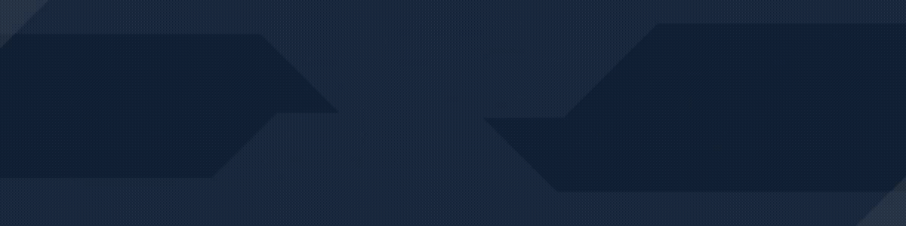

  

Mahasiswa **Teknik Informatika** yang senang memahami bagaimana berbagai hal di dunia ini bekerja,  
mulai dari logika di balik baris kode, keamanan sistem, hingga psikologi warna dan desain visual.

---

### Fokus & Eksplorasi Saat Ini

- **Web Development** 
- **Cybersecurity & CTF** 
- **Problem Solving & Visual Design** 
- **Fun Fact**   Makanan atau minuman manis adalah *mood booster* andalan saat sedang pusing menghadapi *error*.

---

---

### Project Tracker & Fix Reminder

Daftar proyek yang sedang dikerjakan, perlu dirapikan (*fix*), hingga target jangka panjang:

| Nama Project | Deskripsi & Cakupan | Tech Stack | Status / Reminder |
| :--- | :--- | :--- | :--- |
| [**Sistem Akademik**](https://github.com/asololeq/first-projectLaravel) | Pengelolaan data dosen, mahasiswa, dan mata kuliah. | PHP (Laravel) & MySQL |  |
| [**Portal Artikel + Auth**](https://github.com/asololeq/laravel-auth) | Halaman artikel lengkap dengan sistem autentikasi *login*. | PHP (Laravel) & MySQL |  |
| [**First Portfolio Web**🔒](https://github.com/asololeq/my-website) | Website pertamaku yang berfokus pada tampilan antarmuka untuk portofolio. | HTML, CSS & JS |  |
| [**Overcial**🔒](https://github.com/asololeq/first-proj-python) | Aplikasi penghitung pengeluaran dan pengatur target *budget* keuangan. | Python (Django) |  |
| [**Website GP**🔒](https://github.com/asololeq/web-gepek) | *Ultimate Goal Project* — dieksekusi penuh saat seluruh *skill* utama sudah matang. | Full-Stack Mastery |  |

 **Self-Reminder:** *Satu per satu diselesaikan dan di-debug sampai tuntas sebelum lompat terlalu jauh!*

---

### Bahasa & Tools yang Dipelajari

  

    
<b>Programming & System</b>

    

      
    

  

  

    
<b>Design & Visual</b>

    

      
      
      
    

  

---

### Statistik GitHub

  
  
  

